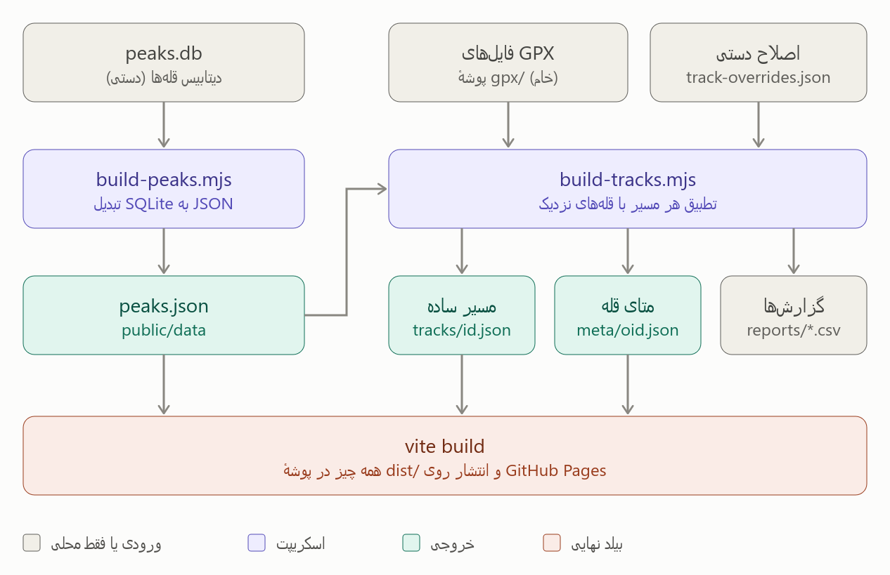
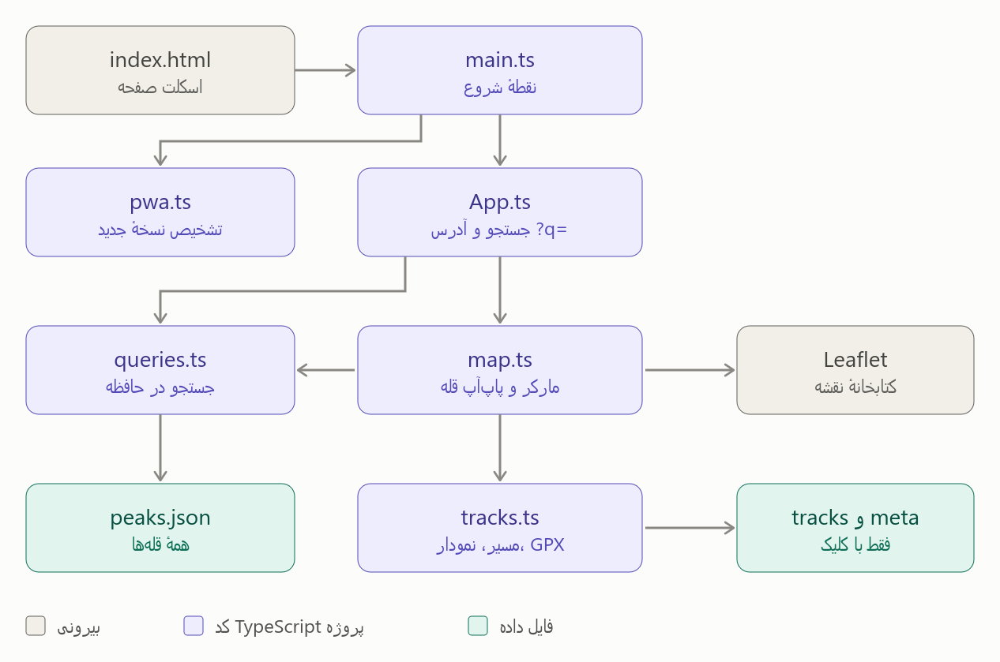

# iranpeaks.ir
<span dir="rtl">
نقشه و جستجوی قله‌های ایران — Vite + TypeScript + Leaflet، قابل نصب (PWA) و کارا در آفلاین.
</span>

## اجرا

```bash
npm install
npm run dev        # سرور توسعه
npm run build      # بیلد محصول (peaks.json + tsc + vite)
npm run preview    # پیش‌نمایش بیلد
```

## لولهٔ داده

```
data/peaks.db          ← دیتابیس مبنا (دستی ویرایش می‌شود؛ در build عمومی کپی نمی‌شود)
   │ npm run peaks     (scripts/build-peaks.mjs — تنها جایی که به sql.js نیاز دارد)
   ▼
public/data/peaks.json ← دادهٔ سبک جستجو در مرورگر (بدون SQLite/wasm)
   │ npm run tracks    (scripts/build-tracks.mjs — تطبیق ترک‌های GPX با قله‌ها)
   ▼
public/tracks/<id>.json       ← مسیر ساده‌شدهٔ هر GPX (فقط ترک‌های متصل‌شده)
public/tracks/meta/<oid>.json ← متادیتای مسیرهای هر قله (لیزی، موقع باز شدن پاپ‌آپ)
reports/                      ← new-peaks.csv (قله‌های ناشناخته) و tracks-review.csv (موارد مشکوک)
```

- <span dir="rtl"> فایل‌های GPX معمولاً در `gpx/` هستند (در .gitignore) و با `npm run tracks` پردازش می‌شوند.</span>
- <span dir="rtl">اصلاح دستیِ تطبیق‌ها: `scripts/track-overrides.json`.</span>

## لینک‌های قابل اشتراک

<span dir="rtl">هر جستجو آدرس مخصوص خودش را دارد (بدون رفرش، با `history.replaceState`):</span>

| لینک | نتیجه |
| --- | --- |
| `/?q=دماوند` | جستجو اجرا می‌شود؛ نتیجهٔ دماوند چندتاست، پس لیست نتایج نمایش داده می‌شود |
| `/?q=سبلان` | اگر جستجو فقط **یک** نتیجه داشته باشد، مستقیم پاپ‌آپ همان قله باز می‌شود |
| `/?q=تهران` | جستجوی استان: همهٔ قله‌های استان روی نقشه |
| `/?q=سبلان&track=سبلان سلطان ساوالان ( شابیل تا قله )` | مسیر هم‌نام همان قله هم خودکار روی نقشه می‌آید و دوربین روی مسیر زوم می‌کند |

- <span dir="rtl"> نرمال‌سازی فارسی فعال است: «كوه» و «کوه» یکی‌اند.</span>
- <span dir="rtl">شناسهٔ دیتابیس (`oid`) و هش مسیر عمداً در URL نمی‌آیند تا کسی نتواند با شمردن idها کل قله‌ها/مسیرها را جمع کند. لینک قله با **نام** (`?q=`) و لینک مسیر با **عنوان** (`&track=`) ساخته می‌شود — دکمه‌های «کپی لینک» در پاپ‌آپ همین کار را می‌کنند.</span>
- <span dir="rtl">نکته: چون تعدادی نام تکراری/مشابه وجود دارد (مثلاً «توچال» و «سیاه سنگ (توچال)»)، بعضی نام‌ها دو نتیجه می‌دهند و لینکشان لیست نتایج را نشان می‌دهد، نه پاپ‌آپ تک‌قله.</span>
- <span dir="rtl">مسیرِ لینک‌شده تا اولین قله‌ای که پاپ‌آپش باز شود «در انتظار» می‌ماند؛ اگر نام قله یکتا باشد همان لحظه باز می‌شود، وگرنه به‌محض باز کردن قلهٔ درست توسط کاربر، مسیرش خودکار روی نقشه می‌آید.</span>

## به‌روزرسانی نسخه (بدون Ctrl+F5)

- <span dir="rtl">در هر بیلد یک `buildId` ساخته می‌شود و در `dist/index.html` به‌صورت `<meta name="app-version">` و داخل `src/pwa.ts` قرار می‌گیرد (پلاگین `app-version` در `vite.config.ts`).</span>
- <span dir="rtl">`src/pwa.ts` هنگام باز شدن تب، برگشتن به برنامه (`visibilitychange`)، آنلاین شدن و هر ۵ دقیقه یک‌بار `/?version=…` را با `cache: 'no-store'` می‌خواند؛ اگر نسخهٔ داخل HTML با `__BUILD_ID__` فرق داشت، صفحه یک‌بار ریلود می‌شود.</span>
- <span dir="rtl">همین مسیر برای PWA نصب‌شده هم کار می‌کند (فقط در حالت `visible` بررسی می‌شود و اگر نسخهٔ سرویس‌ورکر عوض شود، پشتیبان `controllerchange` ریلود می‌کند). در صورت قطع شبکه، بی‌صدا رد می‌شود و بعداً دوباره تلاش می‌کند.</span>

## سئو

- <span dir="rtl">`index.html`: عنوان/description، canonical، Open Graph/Twitter، JSON-LD (`WebSite` + `WebApplication` با `SearchAction` روی `?q=`).</span>
- <span dir="rtl">بخش «بلندترین و مشهورترین قله‌های ایران» در HTML استاتیک با لینک مستقیم `?q=<نام قله>` — محتوای واقعی برای خزنده‌ها و دستیارهای هوش مصنوعی (بدون نیاز به اجرای JS).</span>
- <span dir="rtl">`public/robots.txt` (اجازهٔ صریح به GPTBot/ClaudeBot/PerplexityBot و…) و `public/sitemap.xml`.</span>

<span dir="rtl">یادآوری: چون سایت SPA است، پیش‌نمایش OG برای هر قلهٔ خاص ساخته نمی‌شود (همهٔ لینک‌ها همان تگ‌های صفحهٔ اصلی را دارند)؛ اگر لازم شد باید صفحه‌های استاتیک per-peak تولید شوند.</span>

## جریان یک جستجو (مثلاً «سبلان»)

1. <span dir="rtl">کاربر در `index.html` تایپ می‌کند. `App.ts` رویداد را می‌گیرد و `queries.ts` را صدا می‌زند.</span>
2. <span dir="rtl">`queries.ts` بار اول `peaks.json` را دانلود و نرمال می‌کند (ی/ي، ک/ك، اعداد...). بعد روی همان آرایهٔ درون حافظه جستجو می‌کند.</span>
3. <span dir="rtl">`App.ts` آدرس را به `?q=سبلان` تغییر می‌دهد و `map.ts` را فراخوانی می‌کند. این فایل **تنبل (lazy)** است: Leaflet فقط وقتی نقشه دیده شود یا جستجو انجام شود دانلود می‌شود.</span>
4. <span dir="rtl">`map.ts` برای هر نتیجه یک مارکر می‌گذارد. اگر فقط یک نتیجه باشد، پاپ‌آپ مستقیم باز می‌شود.</span>
5. <span dir="rtl">با باز شدن پاپ‌آپ، `tracks.ts` فایل کوچک `meta/<oid>.json` همان قله را می‌گیرد و فهرست مسیرها را نشان می‌دهد.</span>
6. <span dir="rtl">با کلیک روی یک مسیر، فایل `tracks/<id>.json` دانلود می‌شود و خط مسیر، نمودار ارتفاع و دکمهٔ دانلود GPX روی نقشه می‌آید.</span>

<span dir="rtl">`pwa.ts` مستقل از این جریان کار می‌کند: هر چند دقیقه `index.html` را از سرور می‌خواند و اگر `app-version` فرق داشت، صفحه را ریلود می‌کند.</span>

## راهنمای سریع تایپ‌سکریپت برای خواندن این کد

<span dir="rtl">TypeScript همان JavaScript است با «برچسب نوع». اگر برچسب‌ها را در ذهن حذف کنید، منطق همان JavaScript است.</span>

| در کد | یعنی                                                                                                                                                                                                                                                                                      |
|---|-------------------------------------------------------------------------------------------------------------------------------------------------------------------------------------------------------------------------------------------------------------------------------------------|
| `function f(x: string): number` | <span dir="rtl"> تابع `f` یک رشته می‌گیرد و عدد برمی‌گرداند. `: string` و `: number` فقط برچسب‌اند </span>                                                                                                                                                                                |
| `interface Peak { name: string \| null }` | <span dir="rtl"> شکل یک شیء را توضیح می‌دهد؛ `\| null` یعنی ممکن است خالی باشد. در اجرا چیزی ساخته نمی‌شود                  </span>                                                                                                                                                       |
| `import ... from` / `export` | <span dir="rtl"> استفاده از تابع‌های فایل دیگر / در دسترس گذاشتن تابع برای بقیه                                                                      </span>                                                                                                                              |
| `async` / `await` | <span dir="rtl"> «صبر کن تا این کار (مثلاً دانلود) تمام شود، بعد ادامه بده»                                                                                                   </span>                                                                                                     |
| `a?.b` | <span dir="rtl"> اگر `a` خالی نبود `b` را بده، وگرنه خطا نده                                                                                                                                           </span>                                                                            |
| `a ?? b` | <span dir="rtl"> اگر `a` خالی بود از `b` استفاده کن                                                                                                                                                                             </span>                                                   |
| `x ??= y` | <span dir="rtl"> اگر `x` خالی بود، `y` را در آن بگذار (در کد برای cache استفاده شده)                                                                                                                                                                     </span>                          |
| `as Peak` | <span dir="rtl"> به کامپایلر می‌گویم مطمئنم این از نوع `Peak` است                                                                                                                                                                                                                 </span> |

<span dir="rtl">برای شروع خواندن، این ترتیب را پیشنهاد می‌کنم: `main.ts` (۳ خط) ← `App.ts` ← `queries.ts` ← `map.ts` ← `tracks.ts`. فایل `tracks.ts` طولانی‌ترین و پیچیده‌ترین است. `util.ts` هم فقط چند تابع کمکی دارد که جاهای مختلف صدا زده می‌شود.</span>



